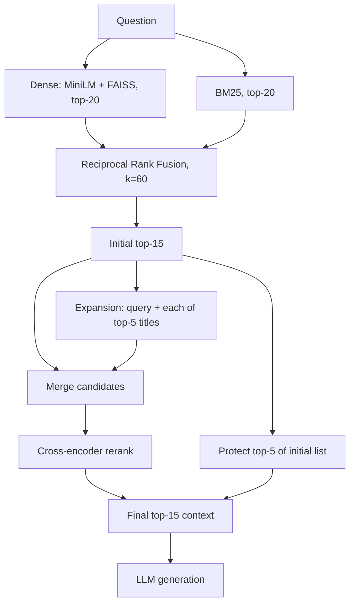

# MultiHop-RAG-Evaluation


A multi-hop RAG system built as an evaluation study on HotpotQA. Instead of treating RAG as a black box, it measures each stage separately: dense retrieval, BM25, hybrid fusion (RRF), cross-encoder reranking, multi-hop query expansion, baseline protection and answer generation. Retrieval errors and generation errors are analysed separately.

**[Live demo](https://multihop-rag-evaluation.streamlit.app/)** · **[Repository](https://github.com/kamaleshpantra/Multihop-RAG-Evaluation)**

## Key results

**Single-stage retrieval.** Recall@K is supporting-fact recall at chunk level (see [Evaluation scope](#evaluation-scope)). Hybrid and reranked rows use `candidate_k = 20`.

| Method | Recall@1 | Recall@5 | Recall@10 | MRR |
|---|---:|---:|---:|---:|
| Dense (MiniLM + FAISS) | 33.72% | 57.75% | 64.36% | 0.4404 |
| BM25 | 31.65% | 57.94% | 67.85% | 0.4308 |
| Hybrid (RRF) | 35.05% | 65.90% | 74.70% | 0.4807 |
| Hybrid + cross-encoder | **43.40%** | **75.30%** | **79.32%** | **0.5731** |

**Multi-hop retrieval and end-to-end answers** (50 HotpotQA dev questions, final top-15 unless noted; answers by Qwen 2.5 Coder 7B via Ollama):

| System | Complete retrieval | Fact coverage | EM | F1 |
|---|---:|---:|---:|---:|
| Baseline RAG (reranked hybrid, K=10) | 64% (32/50) | 82.13% | 42% | 0.4593 |
| Final RAG (baseline-protected multi-hop, K=15) | 70% (35/50) | 85.93% | 44% | 0.5065 |

Findings:
- Dense and BM25 are complementary: fusion beats both on Recall@5/10 and MRR.
- The cross-encoder is the largest single gain (Recall@1 35.05% → 43.40%).
- Multi-hop expansion with baseline protection recovers some missed second-hop evidence (complete retrieval 33 → 35 of 50 questions). The sample is small, so this is suggestive, not a significance-tested result.
- Better retrieval does not guarantee better answers: 17 of 50 final answers were wrong even though all gold evidence was retrieved.

## Architecture



- **RRF** fuses dense and BM25 by rank, so no score calibration is needed.
- **Title expansion** appends each of the top-5 retrieved titles to the question and retrieves again, a lightweight stand-in for iterative reasoning.
- **Cross-encoder** (`ms-marco-MiniLM-L-6-v2`) rescores the merged pool against the original question.
- **Baseline protection** keeps the top-5 of the initial (RRF-ordered) list in the final context; the remaining slots are filled from the reranked pool. It is a heuristic, not a recall guarantee.

## Experiments

- **Candidate-K (fusion pool):** 10 to 100 changes Recall@10 by under 1 point, so `candidate_k = 20` keeps the reranker input small.
- **Retrieval depth:** complete retrieval rises from 58% (K=5) to 66% (K=15) and is flat from K=15 to K=20, so K=15 was used.
- **Multi-hop:** plain expansion reaches 68% complete retrieval (3 questions fixed, 2 regressed); with baseline protection 70% (3 fixed, 1 regressed).
- **Error analysis:** final-system outcomes on 50 questions: retrieval ok and answer ok 18, retrieval ok and answer wrong 17, retrieval failed and answer ok 4, both failed 11. Typical failures are numeric extraction (3,677 answered as 4,000), distractor entities, and rare entities where one hop is missed (e.g. Shirley Temple).

<details>
<summary>Detailed experimental results</summary>

**Candidate-K ablation (hybrid RRF, no reranker)**

| Candidate K | R@1 | R@5 | R@10 | MRR |
|---:|---:|---:|---:|---:|
| 10 | 0.3485 | 0.6612 | 0.7411 | 0.4792 |
| 20 | 0.3505 | 0.6590 | 0.7470 | 0.4807 |
| 50 | 0.3506 | 0.6526 | 0.7451 | 0.4794 |
| 100 | 0.3514 | 0.6496 | 0.7406 | 0.4790 |

**Retrieval-depth ablation (reranked hybrid, 50 questions)**

| K | Complete retrieval | Fact coverage | Fact recall |
|---:|---:|---:|---:|
| 5 | 58% | 79.47% | 78.69% |
| 10 | 64% | 82.13% | 81.97% |
| 15 | 66% | 83.13% | 82.79% |
| 20 | 66% | 83.13% | 82.79% |

**Multi-hop retrieval (50 questions, K=15)**

| System | Complete retrieval | Fact coverage | Fact recall |
|---|---:|---:|---:|
| Reranked hybrid baseline | 66% | 83.13% | 82.79% |
| Multi-hop expansion | 68% | 84.93% | 85.25% |
| Baseline-protected multi-hop | 70% | 85.93% | 86.07% |

**End-to-end outcomes (50 questions)**

| System | Ret. ok / ans ok | Ret. ok / ans wrong | Ret. failed / ans ok | Both failed |
|---|---:|---:|---:|---:|
| Baseline RAG (K=10) | 19 | 13 | 2 | 16 |
| Final RAG (K=15) | 18 | 17 | 4 | 11 |

Exact match changed on 5 of 50 questions: 3 improved, 2 regressed (net +1).

</details>

## Evaluation scope

- **Dataset:** HotpotQA dev, distractor setting; corpus built from the dev contexts and chunked at 500 characters with 100 overlap. This is a controlled distractor setting, not open-domain Wikipedia retrieval.
- **Supporting-fact match:** a chunk matches a gold fact when its title matches and the gold sentence ID is in the chunk's metadata. This is project-specific chunk-level logic, not the official HotpotQA protocol. Recall@K is the fraction of gold facts found in the top K; MRR averages the first-hit reciprocal rank over gold facts.
- **Subsets:** multi-hop retrieval, retrieval-depth and end-to-end results use the first 50 dev questions. The single-stage retrieval scripts have no question limit.
- **Models:** benchmark answers use Qwen 2.5 Coder 7B via Ollama (temperature 0, seed 42). The live demo uses GPT-OSS 20B via the Groq API and is not expected to reproduce these numbers.

## Stack

| Component | Technology |
|---|---|
| Embeddings / vector search | `all-MiniLM-L6-v2`, FAISS (via LangChain) |
| Lexical search | `rank-bm25` |
| Reranker | `cross-encoder/ms-marco-MiniLM-L-6-v2` |
| Benchmark LLM (local) | Qwen 2.5 Coder 7B, Ollama |
| Demo LLM (cloud) | GPT-OSS 20B, Groq API |
| App / tests | Streamlit, pytest |

## Setup (Windows PowerShell)

```powershell
git clone https://github.com/kamaleshpantra/Multihop-RAG-Evaluation.git
cd Multihop-RAG-Evaluation
git lfs pull                      # dataset, chunks and FAISS index are stored in Git LFS
python -m venv .venv
.venv\Scripts\Activate.ps1
pip install -r requirements.txt
ollama pull qwen2.5-coder:7b      # local generation model
streamlit run app/app.py
```

The app uses Groq when `GROQ_API_KEY` is set and local Ollama otherwise. Local benchmarking needs the 7B model and is slow: the 50-question end-to-end run took about 83 minutes on the author's machine.

<details>
<summary>Reproducing the experiments</summary>

Chunks and the FAISS index are already in the repo. To rebuild them:

```powershell
python -m src.data.process_dataset
python -m src.indexing.build_index
```

Evaluations (run from the repository root; outputs are stored in `experiments/`):

```powershell
python -m src.evaluation.evaluate_retrieval
python -m src.evaluation.evaluate_bm25
python -m src.evaluation.evaluate_hybrid
python -m src.evaluation.evaluate_reranker
python -m src.evaluation.evaluate_retrieval_k --limit 50
python -m src.evaluation.evaluate_multihop_retrieval --limit 50
python -m src.evaluation.evaluate_recall_preserving_multihop --limit 50
python -m src.evaluation.evaluate_rag --limit 50
```

`evaluate_rag` runs the final pipeline (K=15). The K=10 baseline predictions in `experiments/generation/rag_predictions.json` came from an earlier configuration that the current script does not reproduce.

</details>

## Limitations and future work

- End-to-end generation and the multi-hop comparisons cover 50 questions. Differences of one or two questions are within noise, and no significance test was run.
- The baseline and final RAG runs differ in both retrieval method and depth (K=10 vs K=15), so the end-to-end gain is not attributable to multi-hop alone.
- Retrieval is scored on the HotpotQA distractor corpus with project-specific chunk-level matching.
- Baseline protection is a heuristic, and expansion costs five extra retrievals per question.
- Faithfulness, answer relevance, context relevance and citation correctness are not implemented. Planned: full dev-set evaluation, those metrics, query decomposition, batched reranking and retrieval caching.

## Project structure

```
src/{data,indexing,retrieval,generation,evaluation}   pipeline, metrics, ablations, error analysis
app/                                                  Streamlit demo
experiments/                                          stored result JSON and plots
tests/                                                unit tests (pytest)
```

Author: [Kamalesh Pantra](https://github.com/kamaleshpantra). No license has been added.
